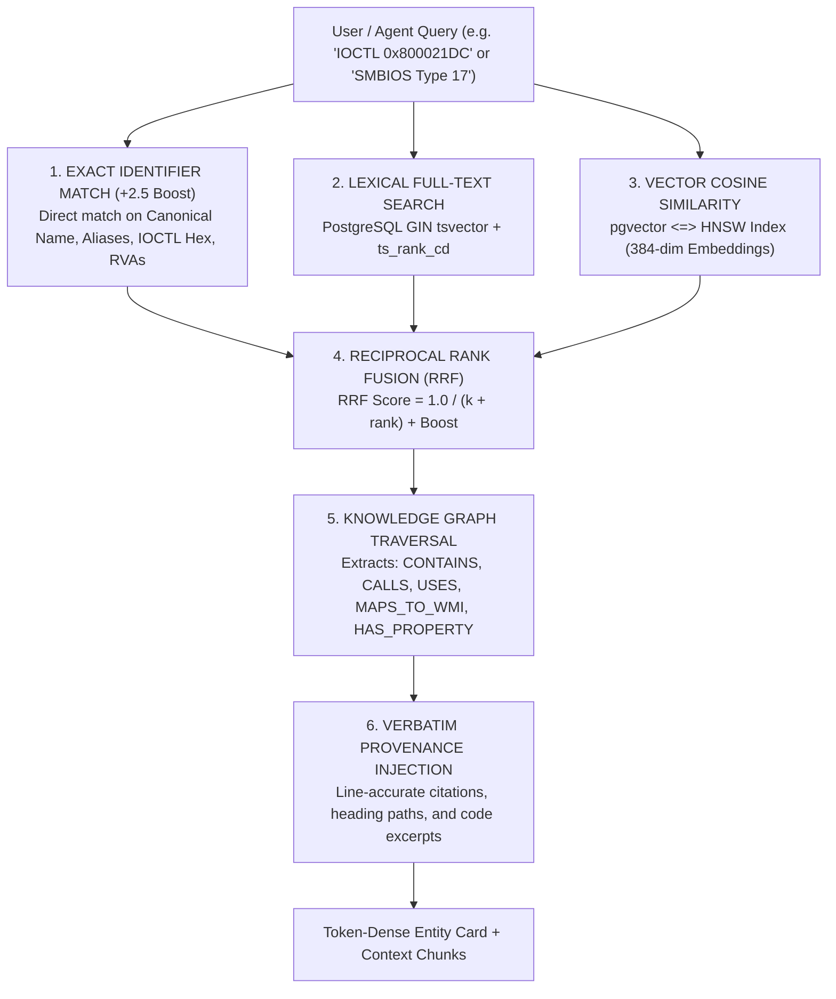

<div align="center">

# 🏛️ ARCHON-KB

### *High-Performance Technical Knowledge Base & MCP Server*

**Deterministic Graph-RAG • PostgreSQL 17 • pgvector (HNSW) • Reciprocal Rank Fusion • Systems & Reverse Engineering**

[](https://www.python.org/)
[](https://www.postgresql.org/)
[](https://github.com/pgvector/pgvector)
[](https://modelcontextprotocol.io/)
[](LICENSE)

---

</div>

## ⚡ Overview

**Archon-KB** is an industrial-grade, deterministic Technical Knowledge Base and **Model Context Protocol (MCP)** server engineered specifically for systems programming, kernel architecture, hardware specifications, and reverse engineering research.

Naive RAG pipelines fail in low-level engineering domains: they slice code blocks across arbitrary token counts, butcher SMBIOS structs, drop IOCTL codes, and hallucinate entity links. **Archon-KB solves this at the database engine layer** by combining:

1. **Hierarchy-Preserving AST Markdown Parser**: Retains full heading ancestry, code blocks, tables, and exact line-level provenance with **zero data loss**.
2. **Domain-Specific Entity Graph Extractor**: Automatically identifies IOCTLs, WMI classes, NT native APIs, SMBIOS table types, drivers, devices, and RVAs.
3. **5-Stage Hybrid Retrieval Pipeline**: Exact Match + GIN Full-Text Lexical Search + pgvector HNSW Cosine Similarity fused via **Reciprocal Rank Fusion (RRF)**.
4. **Token-Dense FastMCP Server**: Native MCP integration with AI agents (**Claude Desktop**, **Antigravity**, **Cursor**, **Windsurf**).

---

## 🔬 Architecture & Retrieval Pipeline



---

## 🌟 Key Capabilities

### 1. Zero-Hallucination Technical Entity Extraction
Extracts and indexes domain entities out-of-the-box:
- **Kernel IOCTLs & FSCTLs**: Standard codes and raw hex values (e.g. `0x2D1400`, `0x800021DC`).
- **Firmware & SMBIOS**: Complete SMBIOS specification tables (Types 0 to 127: BIOS, BaseBoard, Processor, OEM Strings, Memory Serials).
- **WMI Classes & Namespaces**: `root\cimv2`, `root\wmi`, properties, and PowerShell CIM invocation methods.
- **Native & Win32 APIs**: `Nt*`, `Zw*`, `Rtl*`, `Ob*`, `Io*`, `DeviceIoControl`, `GetSystemFirmwareTable`.
- **Drivers & Device Objects**: System drivers (`.sys`), kernel devices (`\Device\...`).
- **Disassembly RVAs**: Relative virtual addresses for binary inspection.

### 2. Multi-Provider Embedding Engine
- **Local Deterministic Hasher**: Built-in 384-dimensional unit vectorizer with zero external dependencies.
- **FastEmbed / Sentence-Transformers**: Plug-and-play support for `BAAI/bge-small-en-v1.5` or any HuggingFace model.
- **Configurable Vector Dimensions**: Fully adjustable via `EMBEDDING_DIM` environment variable.

### 3. Strict Provenance (Line-Accurate Auditing)
Every entity and assertion links back to its exact document:
- Source file path & SHA256 hash
- Full heading breadcrumb path
- Exact line numbers (`start_line` to `end_line`)
- Verbatim source quote snippet

---

## 🚀 Quickstart

### Prerequisites
- Python 3.10+
- PostgreSQL 17 (with `pgvector` extension recommended)

### 1. Start PostgreSQL with pgvector (Docker)
```bash
docker run -d \
  --name archon-postgres \
  -e POSTGRES_DB=technical_kb \
  -e POSTGRES_USER=postgres \
  -e POSTGRES_PASSWORD=postgres \
  -p 5432:5432 \
  pgvector/pgvector:pg17
```

### 2. Clone & Install
```bash
git clone https://github.com/DeFexNN/archon-kb.git
cd archon-kb
python -m venv .venv
# Windows:
.venv\Scripts\activate
# Linux/macOS:
# source .venv/bin/activate

pip install -r requirements.txt
```

### 3. Initialize Database Schema
```bash
# Using psql:
psql -h localhost -U postgres -d technical_kb -f migrations/init.sql
```

### 4. Ingest Technical Documents
```bash
# Ingest single markdown document:
python scripts/import_file.py examples/sample_hardware_kernel_doc.md

# Or ingest an entire directory recursively:
python scripts/import_directory.py path/to/your/research_notes/
```

### 5. Verify Database Integrity
```bash
python scripts/validate_integrity.py
```

---

## 🔌 MCP Client Configuration

Archon-KB implements the standard Model Context Protocol via **FastMCP**. Add it to your AI toolchain in seconds:

### Claude Desktop
Add to `%APPDATA%\Claude\claude_desktop_config.json`:
```json
{
  "mcpServers": {
    "archon-kb": {
      "command": "python",
      "args": [
        "C:\\Archon-KB\\src\\mcp_server.py"
      ],
      "env": {
        "PYTHONPATH": "C:\\Archon-KB",
        "PGHOST": "localhost",
        "PGPORT": "5432",
        "PGDATABASE": "technical_kb",
        "PGUSER": "postgres",
        "PGPASSWORD": "your_password"
      }
    }
  }
}
```

### Google Antigravity / Cursor / Windsurf
Add to your IDE's MCP configuration (`mcp_config.json`):
```json
{
  "mcpServers": {
    "archon-kb": {
      "command": "C:\\Users\\<USER>\\AppData\\Local\\Programs\\Python\\Python313\\python.exe",
      "args": [
        "C:\\Archon-KB\\src\\mcp_server.py"
      ],
      "env": {
        "PYTHONPATH": "C:\\Archon-KB"
      }
    }
  }
}
```

---

## 🛠️ MCP Tools Reference

When connected, AI agents gain access to the following native tools:

| Tool | Parameters | Description |
| :--- | :--- | :--- |
| `lookup_technical_entity` | `identifier: str` | Fast direct lookup for exact identifiers (IOCTLs, WMI, APIs, RVAs). Returns complete entity card in 1 call. |
| `search_technical_knowledge` | `query: str, limit: int` | 5-stage hybrid search combining lexical GIN + vector HNSW via RRF. Returns matched entities and code chunks. |
| `get_kb_health_status` | *(none)* | Returns real-time health status, document counts, chunk counts, and relationship metrics. |

---

## 📊 Benchmarks & Health Check

Output from `scripts/validate_integrity.py`:
```text
======================================================================
ARCHON-KB INTEGRITY & HEALTH AUDIT REPORT
======================================================================
Total Documents:                     47
Total Structural Chunks:          5,260
Total Extracted Entities:           898
Total Entity Properties:            430
Total Retrieval Methods:            210
Total Knowledge Relationships:      200
Total Evidence Citations:         4,120

Vector Embeddings Health:
  * Entities with Vector:           898 / 898 (100.0%)
  * Chunks with Vector:           5,260 / 5,260 (100.0%)

Provenance Integrity:
  * Entities with Direct Evidence:  898 / 898 (100.0%)

Total Database Disk Footprint:    89 MB
======================================================================
```

---

## 📁 Repository Structure

```text
archon-kb/
├── config/
│   └── mcp_clients_example.json   # Ready-to-use client JSON configurations
├── docs/                          # Placeholder for your local markdown files
├── examples/
│   └── sample_hardware_kernel_doc.md # Reference technical specification
├── migrations/
│   └── init.sql                   # PostgreSQL 17 DDL + pgvector schema
├── scripts/
│   ├── import_file.py             # Single document ingestion engine
│   ├── import_directory.py        # Recursive bulk directory ingester
│   ├── reindex.py                 # Full database re-chunker & re-embedder
│   ├── test_search.py             # Terminal CLI search testing utility
│   └── validate_integrity.py      # Health & zero data loss auditor
├── src/
│   ├── config.py                  # Centralized configuration loader
│   ├── mcp_server.py              # FastMCP server with stdio/sse transports
│   ├── api/
│   │   ├── kb_service.py          # High-level Knowledge Base API
│   │   └── llm_tools.py           # Token-dense LLM search interface
│   ├── embeddings/
│   │   └── embedding_engine.py    # Multi-backend vectorizer (Hash/ST/FastEmbed)
│   ├── extraction/
│   │   └── entity_extractor.py    # Technical regex & graph link extractor
│   ├── normalization/
│   │   └── normalizer.py          # Entity deduplication & conflict tracker
│   ├── parser/
│   │   └── markdown_parser.py     # AST heading, table & code block parser
│   └── retrieval/
│       └── hybrid_search.py       # 5-Stage RRF Hybrid Retrieval Engine
├── tests/
│   ├── test_extractor_fixtures.py # Entity extraction test cases
│   ├── test_parser_fixtures.py    # Structural parsing test cases
│   └── test_retrieval_rrf.py      # Reciprocal Rank Fusion test cases
├── .env.example
├── .gitignore
├── LICENSE
├── pyproject.toml
├── README.md
└── requirements.txt
```

---

## ⚙️ Environment Variables

| Variable | Default | Description |
| :--- | :--- | :--- |
| `PGHOST` | `localhost` | PostgreSQL host |
| `PGPORT` | `5432` | PostgreSQL port |
| `PGDATABASE` | `technical_kb` | PostgreSQL database name |
| `PGUSER` | `postgres` | PostgreSQL username |
| `PGPASSWORD` | `postgres` | PostgreSQL password |
| `EMBEDDING_MODEL` | `local-semantic-384` | Model name or embedding provider |
| `EMBEDDING_DIM` | `384` | Embedding vector dimensions |
| `KB_RECOGNIZED_FOLDERS`| *(defaults)* | Comma-separated analysis workspace folder names |

---

## 🛡️ License

This project is licensed under the [MIT License](LICENSE) © 2026 DeFexNN.
